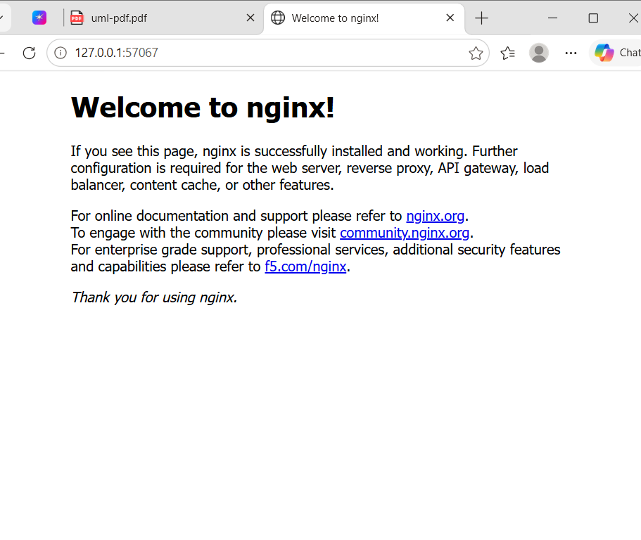
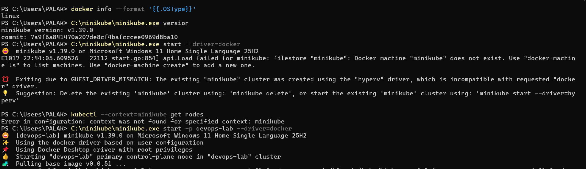
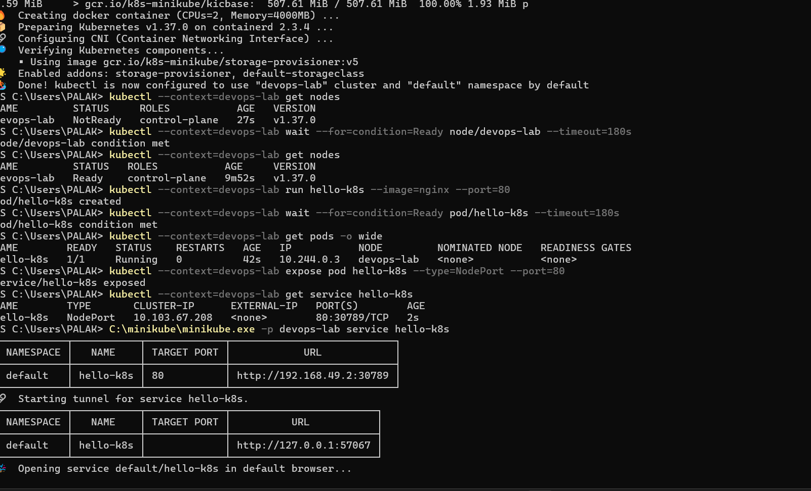

# Lab 1: Running Nginx on Kubernetes

[Back to assignment index](../README.md)

Run the commands from the repository root unless a step specifies another directory.

I started with an Nginx container on Minikube. The aim was to get a Pod running and open its welcome page in the browser.

## 1. Checked Docker and Minikube

I first checked that Docker was using Linux containers and confirmed the Minikube version.

```powershell
docker info --format '{{.OSType}}'
C:\minikube\minikube.exe version
```

Docker returned `linux`, and Minikube was version `v1.39.0`.

## 2. Started the Kubernetes cluster

My first attempt used the default Minikube profile:

```powershell
C:\minikube\minikube.exe start --driver=docker
```

This failed with `GUEST_DRIVER_MISMATCH` because the existing profile was configured for Hyper-V. I used a separate profile called `devops-lab` with the Docker driver:

```powershell
C:\minikube\minikube.exe start -p devops-lab --driver=docker
```

Minikube downloaded the required image and started Kubernetes `v1.37.0`.

## 3. Waited for the node to become ready

```powershell
kubectl --context=devops-lab get nodes
kubectl --context=devops-lab wait --for=condition=Ready node/devops-lab --timeout=180s
kubectl --context=devops-lab get nodes
```

The node initially showed `NotReady`. After waiting, its status changed to `Ready`.

## 4. Created the Nginx Pod

```powershell
kubectl --context=devops-lab run hello-k8s --image=nginx --port=80
kubectl --context=devops-lab wait --for=condition=Ready pod/hello-k8s --timeout=180s
kubectl --context=devops-lab get pods -o wide
```

The Pod was created successfully. It showed `1/1` ready, a status of `Running`, and `0` restarts on the `devops-lab` node.

## 5. Exposed the Pod using a Service

```powershell
kubectl --context=devops-lab expose pod hello-k8s --type=NodePort --port=80
kubectl --context=devops-lab get service hello-k8s
```

The Service was named `hello-k8s`. It mapped port `80` to node port `30789`, shown as `80:30789/TCP`.

## 6. Opened the Nginx welcome page

```powershell
C:\minikube\minikube.exe -p devops-lab service hello-k8s
```

Minikube started a tunnel and opened `http://127.0.0.1:57067` in the browser. I kept the PowerShell window open to keep the tunnel running.

The browser displayed **Welcome to nginx!**, confirming that I could access the application running in Kubernetes.




## 7. Uploaded the lab to GitHub

From the local repository folder, I pushed the committed lab files:

```powershell
git push origin main
```

The push completed successfully with commit `f573bbd`.

I also included the [Pod YAML](pod.yaml) and [Service YAML](service.yaml) so the same resources can be created from files. In this run, I created them with the commands above.

## Additional screenshots




