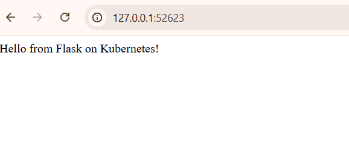
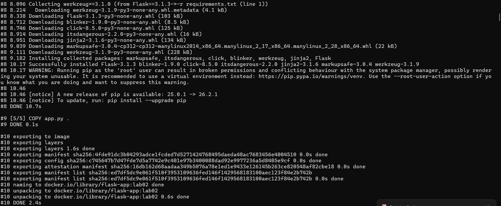
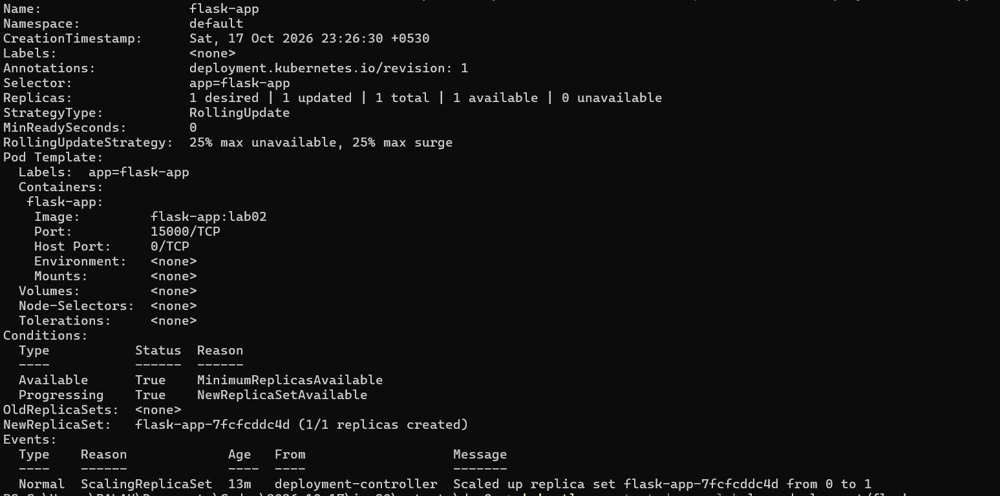

# Lab 2: Deploying Flask on Minikube

[Back to assignment index](../README.md)

Run the commands from the repository root unless a step specifies another directory.

Next, I deployed a small Flask app that returns `Hello from Flask on Kubernetes!` on port `15000`. The app, Dockerfile and Kubernetes YAML are in [lab-02](./).

## 1. Built the application image

From the repository folder, I built the image using the files in `lab-02`:

```powershell
docker build -t flask-app:lab02 .\lab-02
```

The first build was cancelled while installing dependencies. I ran it again with detailed output:

```powershell
docker build --progress=plain -t flask-app:lab02 .\lab-02
```

The second build finished and created `flask-app:lab02`, using Python 3.12 and Flask 3.1.3.

## 2. Loaded the image into Minikube

```powershell
C:\minikube\minikube.exe -p devops-lab image load flask-app:lab02
```

I loaded the image into the existing cluster so Kubernetes could use it locally. The manifest uses `imagePullPolicy: Never` with the same image tag.

## 3. Created the Deployment and Service

```powershell
kubectl --context=devops-lab apply -f .\lab-02\flask-deployment.yaml
kubectl --context=devops-lab rollout status deployment/flask-app --timeout=180s
```

Kubernetes created the `flask-app` Deployment and `flask-app-service` Service. The rollout completed successfully.

## 4. Checked the application

```powershell
kubectl --context=devops-lab get pods -l app=flask-app -o wide
kubectl --context=devops-lab get service flask-app-service
kubectl --context=devops-lab get deployments
kubectl --context=devops-lab describe deployment flask-app
kubectl --context=devops-lab logs deployment/flask-app
```

The Pod `flask-app-7fcfcddc4d-6ftjk` showed `1/1` ready, `Running`, and zero restarts. The Deployment had one available replica. The logs confirmed that Flask was listening on port `15000`.

The NodePort Service mapped port `15000` to node port `30856`, shown as `15000:30856/TCP`.

## 5. Opened the Flask application

```powershell
C:\minikube\minikube.exe -p devops-lab service flask-app-service --url
```

Minikube returned `http://127.0.0.1:52623`. I kept the terminal open and opened the URL in my browser. The page displayed **Hello from Flask on Kubernetes!**.



## Additional screenshots




