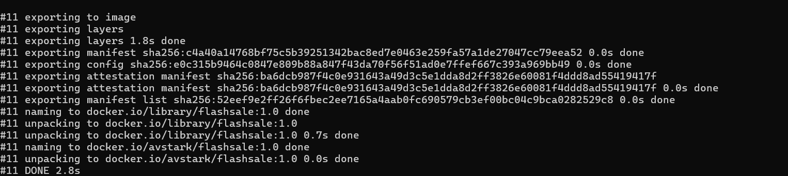
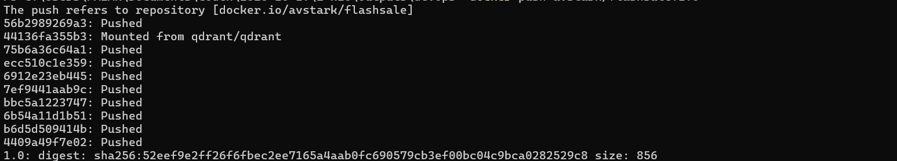
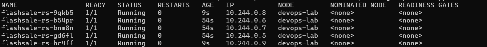
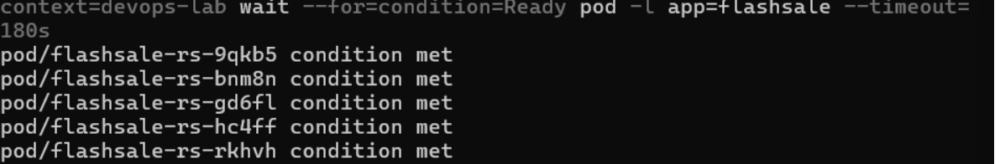

# Lab 3: Scaling a Flask App with a ReplicaSet

[Back to all labs](../)

Run the commands from the repository root unless a step specifies another directory.

For the scaling lab, I used the flash-sale Flask app from the exercise. It has `/`, `/buy`, and `/health` endpoints. I ran it on the same single-node cluster, first with three Pods and then with five. The files are in [lab-03](./).

## 1. Built and uploaded the image

I built the image with a local tag and a Docker Hub tag:

```powershell
docker build --progress=plain -t flashsale:1.0 -t avstark/flashsale:1.0 .\lab-03
docker push avstark/flashsale:1.0
```

The build and Docker Hub upload completed successfully. I then loaded the local image into Minikube:

```powershell
C:\minikube\minikube.exe -p devops-lab image load flashsale:1.0
```

## 2. Started three replicas

```powershell
kubectl --context=devops-lab apply -f .\lab-03\flashsale-replicaset.yaml
kubectl --context=devops-lab wait --for=condition=Ready pod -l app=flashsale --timeout=180s
kubectl --context=devops-lab get rs flashsale-rs
kubectl --context=devops-lab get pods -l app=flashsale -o wide
```

This created the `flashsale-rs` ReplicaSet and `flashsale-svc` Service. The ReplicaSet showed `3` desired, `3` current, and `3` ready Pods. All three Pods were running on `devops-lab`.

## 3. Scaled from three Pods to five

```powershell
kubectl --context=devops-lab scale rs flashsale-rs --replicas=5
kubectl --context=devops-lab wait --for=condition=Ready pod -l app=flashsale --timeout=180s
kubectl --context=devops-lab get rs flashsale-rs
kubectl --context=devops-lab get pods -l app=flashsale -o wide
```

Kubernetes created two additional Pods, `flashsale-rs-9qkb5` and `flashsale-rs-hc4ff`. The ReplicaSet then showed `5` desired, `5` current, and `5` ready Pods.

## 4. Deleted a Pod and checked its replacement

```powershell
kubectl --context=devops-lab delete pod flashsale-rs-b54pr
kubectl --context=devops-lab wait --for=condition=Ready pod -l app=flashsale --timeout=180s
kubectl --context=devops-lab get rs flashsale-rs
kubectl --context=devops-lab get pods -l app=flashsale -o wide
```

After I deleted `flashsale-rs-b54pr`, the ReplicaSet created `flashsale-rs-rkhvh` to replace it. The replacement became ready, bringing the total back to five running Pods with zero restarts.

| Pod after replacement | Status | Node |
| --- | --- | --- |
| flashsale-rs-9qkb5 | 1/1 Running | devops-lab |
| flashsale-rs-bnm8n | 1/1 Running | devops-lab |
| flashsale-rs-gd6fl | 1/1 Running | devops-lab |
| flashsale-rs-hc4ff | 1/1 Running | devops-lab |
| flashsale-rs-rkhvh | 1/1 Running | devops-lab |

Deleting a Pod did not reduce the replica count permanently: Kubernetes created a replacement to bring it back to five. All five copies ran on the same node because this was still a single-node cluster.

## Additional screenshots








