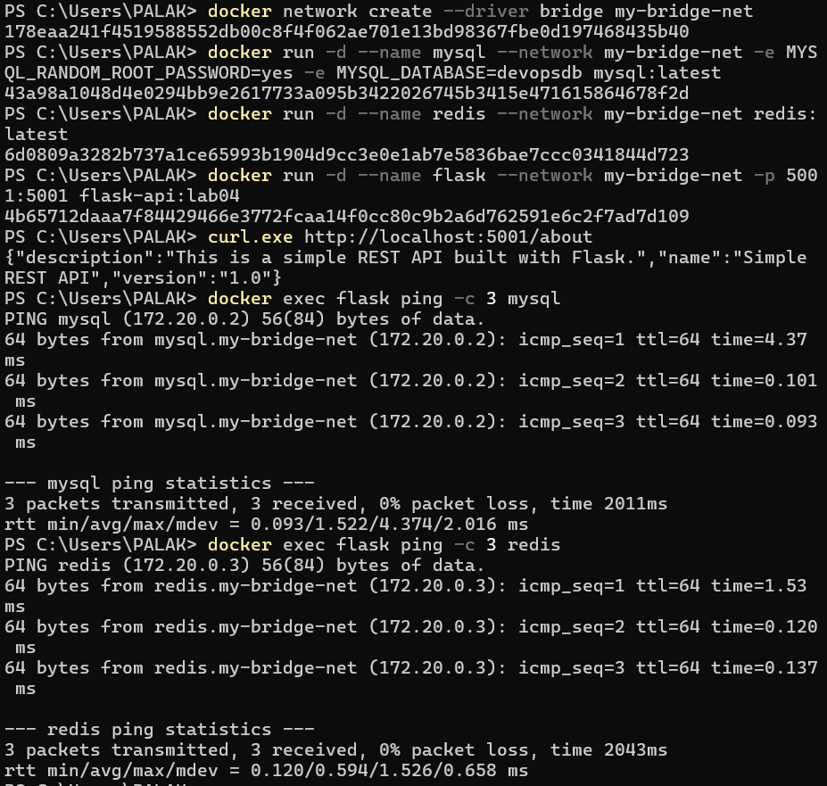
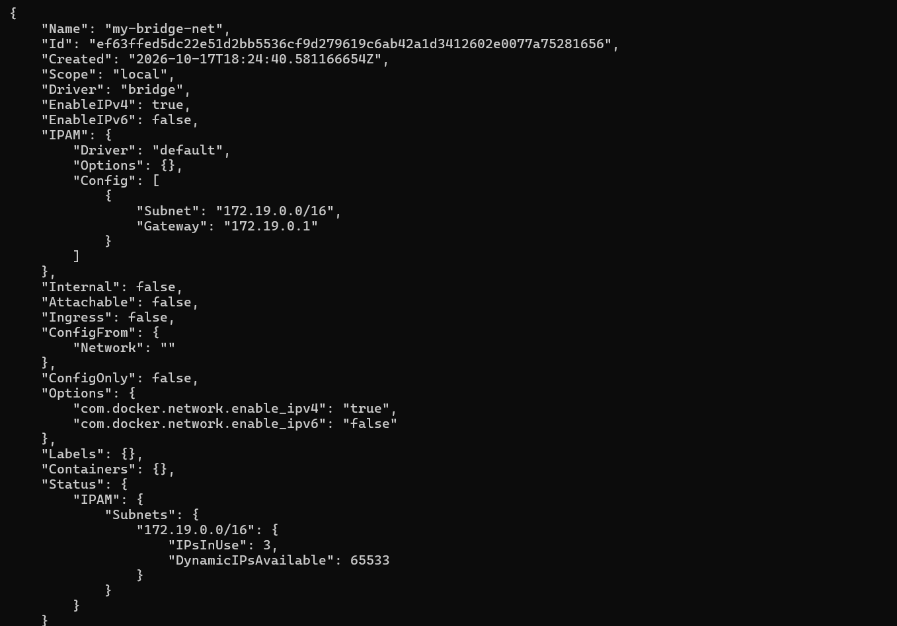
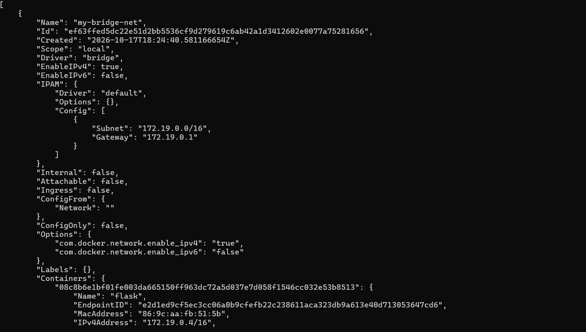

# Lab 4: Docker Networking with Flask, MySQL and Redis

[Back to all labs](../)

Run the commands from the repository root unless a step specifies another directory.

I used a custom bridge network to connect a Flask API, MySQL and Redis. The main checks were whether Flask responded from my laptop and whether its container could reach the other two containers by name. The Flask files are in [lab-04](./).

## 1. Created and inspected the network

I checked the existing containers and networks before creating the lab network:

```powershell
docker ps -a
docker network ls
docker network create --driver bridge my-bridge-net
docker network ls
docker network inspect my-bridge-net
```

Docker created `my-bridge-net` with the bridge driver, subnet `172.19.0.0/16` and gateway `172.19.0.1`. No containers were attached at this point.

## 2. Built the Flask image

The Flask app serves `/about` on port `5001`. I used `host='0.0.0.0'` so it could accept requests through the container network. The Dockerfile also installs `ping` for the connectivity tests.

```powershell
docker build --progress=plain -t flask-api:lab04 .\lab-04
```

The first build got stuck downloading Debian packages and reported connection timeouts. I switched the repository URLs to HTTPS, added retry limits in the Dockerfile, and ran the build again. That build finished.

## 3. Started the three containers

```powershell
docker run -d --name mysql --network my-bridge-net -e "MYSQL_ROOT_PASSWORD=<redacted>" -e MYSQL_DATABASE=devopsdb mysql:latest
docker run -d --name redis --network my-bridge-net redis:latest
docker run -d --name flask --network my-bridge-net -p 5001:5001 flask-api:lab04
docker ps
```

All three containers stayed running. I have replaced the local test password with `<redacted>` in these recorded commands.

## 4. Tested Flask from the host

```powershell
curl.exe http://localhost:5001/about
```

The response was:

```json
{"description":"This is a simple REST API built with Flask.","name":"Simple REST API","version":"1.0"}
```

The `-p 5001:5001` option forwards port `5001` on my laptop to port `5001` inside the Flask container.

## 5. Checked container-to-container communication

```powershell
docker network inspect my-bridge-net
docker exec flask ping -c 3 mysql
docker exec flask ping -c 3 redis
```

The network inspection listed all three containers:

| Container | IP address |
| --- | --- |
| mysql | 172.19.0.2 |
| redis | 172.19.0.3 |
| flask | 172.19.0.4 |

Both `ping mysql` and `ping redis` worked from the Flask container, with **0% packet loss**. I could use the container names because they were on the same custom bridge network. The `--network` option connected each container to that network.

## 6. Verified Redis and MySQL

```powershell
docker exec redis redis-cli ping
docker exec mysql mysql -uroot '-p<redacted>' -e "SHOW DATABASES;"
```

Redis returned `PONG`. MySQL listed `devopsdb`, `information_schema`, `mysql`, `performance_schema` and `sys`.

Only Flask needed a published host port for these tests. MySQL and Redis communicated within the bridge network. A bridge gives containers their own network namespaces; host networking shares the host's network namespace.

## 7. Cleaned up the lab

```powershell
docker stop mysql redis flask
docker rm mysql redis flask
docker network rm my-bridge-net
docker ps -a
docker network ls
```

Docker stopped and removed all three lab containers, then removed `my-bridge-net`. The final checks confirmed that the lab containers and custom network were gone.

## 8. Captured the final connectivity screenshot

I recreated the lab network and its three containers using the existing images to capture the results. For this run, I used MySQL's random-password option rather than putting a password in the command:

```powershell
docker network create --driver bridge my-bridge-net
docker run -d --name mysql --network my-bridge-net -e MYSQL_RANDOM_ROOT_PASSWORD=yes -e MYSQL_DATABASE=devopsdb mysql:latest
docker run -d --name redis --network my-bridge-net redis:latest
docker run -d --name flask --network my-bridge-net -p 5001:5001 flask-api:lab04
curl.exe http://localhost:5001/about
docker exec flask ping -c 3 mysql
docker exec flask ping -c 3 redis
```

Flask returned the expected API details again. MySQL resolved to `172.20.0.2` and Redis to `172.20.0.3` on this recreated network. Both ping tests received all three replies with zero packet loss. These addresses differ from the first run because Docker assigned a subnet when the network was recreated.



## Additional screenshots




