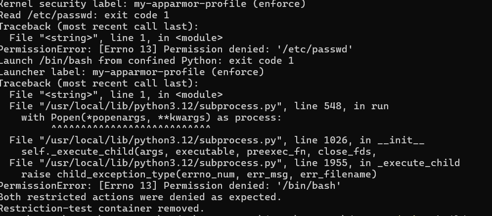
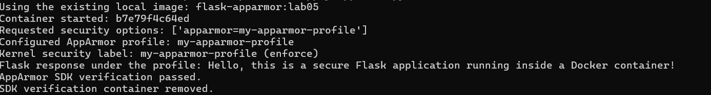

# Lab 5: Docker Security with AppArmor and Python

[Back to all labs](../)

Run the commands from the repository root unless a step specifies another directory.

In this lab, I applied an AppArmor profile to a Flask container and used Python's Docker SDK to test it. Getting the profile to actually enforce the restrictions needed extra setup in WSL. The app, profile and scripts are in [lab-05](./).

The commands in this section use my current checkout at `C:\Users\PALAK\Documents\devOps`. The image archive is saved in Documents, outside the repository. The screenshots record the original runs; updating these command paths does not represent a new execution of the labs.

## 1. Enabled AppArmor in WSL

I checked the Docker security options and the Ubuntu kernel:

```powershell
docker info --format '{{json .SecurityOptions}}'
wsl --list --verbose
wsl -d Ubuntu-22.04 -- uname -r
wsl -d Ubuntu-22.04 -- cat /sys/module/apparmor/parameters/enabled
```

AppArmor was initially disabled (`N`). I added the following to `%USERPROFILE%\.wslconfig`, quit Docker Desktop, and restarted WSL:

```ini
[wsl2]
kernelCommandLine=apparmor=1 security=apparmor
```

```powershell
wsl --shutdown
wsl -d Ubuntu-22.04 -- cat /sys/module/apparmor/parameters/enabled
```

The result changed to `Y`. After reopening Docker Desktop, its security options also listed AppArmor.

## 2. Loaded the custom profile

Ubuntu already had `apparmor_parser`. I mounted the security filesystem, copied the profile and loaded it:

```powershell
wsl -d Ubuntu-22.04 -u root -- mount -t securityfs securityfs /sys/kernel/security
wsl -d Ubuntu-22.04 -u root -- cp /mnt/c/Users/PALAK/Documents/devOps/lab-05/my-apparmor-profile /etc/apparmor.d/my-apparmor-profile
wsl -d Ubuntu-22.04 -u root -- apparmor_parser -r /etc/apparmor.d/my-apparmor-profile
wsl -d Ubuntu-22.04 -u root -- cat /sys/kernel/security/apparmor/profiles
```

The kernel listed `my-apparmor-profile (enforce)`. The profile denies reading `/etc`, reading or writing `/var`, executing programs under `/bin` and `/usr/bin`, and using the `sys_admin` capability. Python remains available under `/usr/local/bin`.

## 3. Built and checked the Flask image

```powershell
docker build --progress=plain -t flask-apparmor:lab05 .\lab-05
docker run -d --name lab05-flask --security-opt apparmor=my-apparmor-profile -p 5000:5000 flask-apparmor:lab05
docker inspect --format '{{.AppArmorProfile}}' lab05-flask
curl.exe http://localhost:5000
```

Flask started and returned the expected greeting, and Docker inspection showed the profile name. But the process label was still `unconfined`. The container could read `/etc/passwd` and run Bash, so the profile name alone did not prove that the restrictions were working.

I also mounted securityfs in `docker-desktop` and confirmed it could see the profile, but a fresh container remained unconfined. Its environment did not have `/sbin/apparmor_parser`. I used Ubuntu's own Docker engine for the working enforcement tests.

## 4. Set up Ubuntu's Docker engine and Python SDK

I saved the existing image, disabled Docker Desktop's Ubuntu-22.04 integration, and installed Docker in Ubuntu:

```powershell
docker save -o "$env:USERPROFILE\Documents\lab05-flask.tar" flask-apparmor:lab05
wsl -d Ubuntu-22.04 -u root -- apt-get update
wsl -d Ubuntu-22.04 -u root -- apt-get install -y python3.10-venv
wsl -d Ubuntu-22.04 -u root -- apt-get install -y docker.io
wsl -d Ubuntu-22.04 -u root -- sh -c 'mountpoint -q /sys/kernel/security || mount -t securityfs securityfs /sys/kernel/security'
wsl -d Ubuntu-22.04 -u root -- apparmor_parser -r /etc/apparmor.d/my-apparmor-profile
wsl -d Ubuntu-22.04 -u root -- service docker restart
wsl -d Ubuntu-22.04 -u root -- docker info --format 'Server={{.ServerVersion}} OS={{.OperatingSystem}} Security={{json .SecurityOptions}}'
wsl -d Ubuntu-22.04 -u root -- docker load -i /mnt/c/Users/PALAK/Documents/lab05-flask.tar
```

This engine reported Docker `29.1.3`, Ubuntu `22.04.5 LTS`, and AppArmor support. The saved image loaded successfully.

I created a virtual environment and installed the Docker SDK:

```powershell
wsl -d Ubuntu-22.04 -- python3 -m venv /tmp/devops-lab5-venv
wsl -d Ubuntu-22.04 -- /tmp/devops-lab5-venv/bin/pip install -r /mnt/c/Users/PALAK/Documents/devOps/lab-05/sdk-requirements.txt
```

My first attempt to create the virtual environment failed because `ensurepip` was missing. After installing `python3.10-venv`, I created it again. I also changed the SDK script to use the existing image because rebuilding it from WSL had failed with a Windows credential-helper error.

## 5. Verified the profile and restricted actions using Python

```powershell
wsl -d Ubuntu-22.04 -u root -- /tmp/devops-lab5-venv/bin/python /mnt/c/Users/PALAK/Documents/devOps/lab-05/apply_apparmor.py
wsl -d Ubuntu-22.04 -u root -- /tmp/devops-lab5-venv/bin/python /mnt/c/Users/PALAK/Documents/devOps/lab-05/test_restricted_actions.py
```

The first script confirmed the kernel label `my-apparmor-profile (enforce)` and received the Flask greeting while the profile was active.

The restriction tests produced:

| Action from the confined Python process | Result |
| --- | --- |
| Read `/etc/passwd` | Exit code 1; `PermissionError: Permission denied` |
| Launch `/bin/bash` using `subprocess.run` | Exit code 1; `PermissionError: Permission denied` |

Running Bash directly through Docker exec was still allowed. To check what the confined app could do, I tested a Bash launch from Python after confirming Python's enforcing label. That attempt failed with `PermissionError`, as did reading `/etc/passwd`.

The script printed `Both restricted actions were denied as expected.` Both SDK scripts removed their temporary containers after running.



## Additional screenshots


