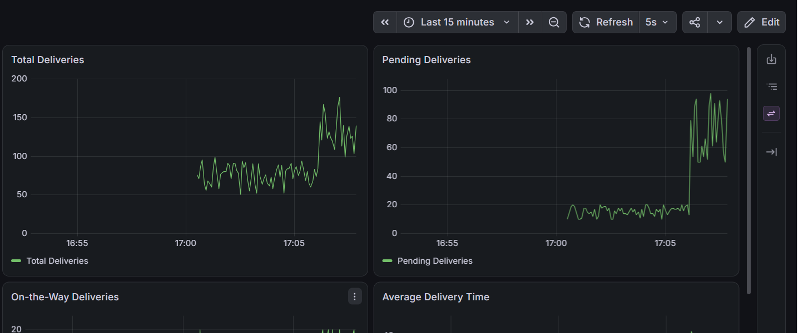
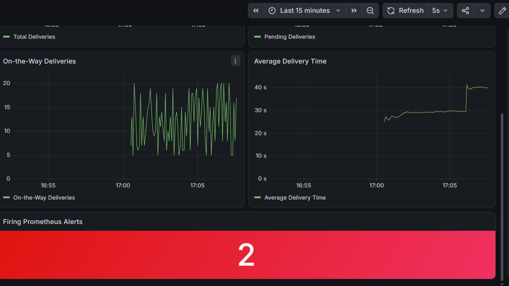
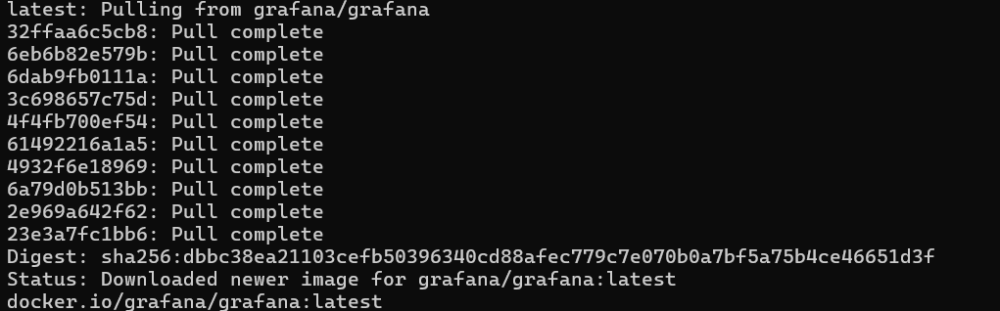

# Lab 6: Delivery Monitoring

[Back to assignment index](../README.md)

Run the commands from the repository root unless a step specifies another directory.

For this lab, I simulated delivery activity in Python, collected its metrics with Prometheus, and viewed them in Grafana. Jenkins started the services. I used the four metrics from the handout: total deliveries, pending deliveries, on-the-way deliveries, and delivery times. For average delivery time, the dashboard divides the Summary's total time by its observation count.

I added the missing metrics Dockerfile and used Docker Compose to start the three services on one network. Prometheus scrapes `metrics:8000`, and Grafana connects to `http://prometheus:9090`. These Docker service names replace the handout's fixed Linux host IP. I saved Grafana's data source and dashboard in configuration files so the pipeline can recreate them.

I created a Pipeline job named `Delivery-Monitoring`, pasted `lab-06/Jenkinsfile` into the Pipeline script field, and ran it with `USE_LOCAL_SOURCE` checked and `ALERT_DEMO` unchecked.

Build #1 failed after a network interruption left the Prometheus and Grafana image layers incomplete (`short read ... unexpected EOF`). I downloaded both images from PowerShell:

```powershell
docker pull prom/prometheus:latest
docker pull grafana/grafana:latest
```

After both images downloaded, I used Build with Parameters to run the job again with the same settings.

Build #2 built all three images. `promtool` validated `prometheus.yml` and found both alert rules. Jenkins started the services and checked the running stack:

| Check in build #2 | Result |
| --- | --- |
| Grafana health | OK |
| Prometheus delivery-service scrape target | UP |
| Total deliveries | 64 |
| Pending deliveries | 19 |
| On-the-way deliveries | 14 |
| Average delivery time | About 25.71 seconds |

These were the simulated values when the check ran; they change as the app runs. At that point, no alerts were firing. The console ended with `Monitoring verification passed.` and `Finished: SUCCESS`.

The services were available at `http://localhost:8001/metrics`, `http://localhost:9090`, and `http://localhost:3000`. The metrics container still listens on port 8000; Docker publishes it on host port 8001.

I opened Grafana's Delivery Operations dashboard and checked that all four charts displayed data. The alert-count panel shows how many Prometheus alerts are firing; it does not identify them by name.


I then ran build #3 with both `USE_LOCAL_SOURCE` and `ALERT_DEMO` checked. The demo mode raises pending deliveries to 50–100 and delivery times to 35–45 seconds. It recreates the metrics container with that setting and waits for both rules to fire.

The check reported 50 pending deliveries and an average delivery time of about 40.00 seconds. Prometheus reported both `HighPendingDeliveries` (warning) and `HighAverageDeliveryTime` (critical) as firing. Both rules require their conditions to stay true for 15 seconds; I added the missing duration to the average-time rule so it matches the handout's description.

Build #3 also finished successfully, this time with both alerts firing. I checked the alerts through Prometheus and the Grafana count panel. I did not set up email or chat notifications for this exercise.

I refreshed Grafana after the demo run. The pending-deliveries chart rose into the 50–100 range, the average-time chart moved to about 40 seconds, and the firing-alert count reached 2.





## Additional screenshots


