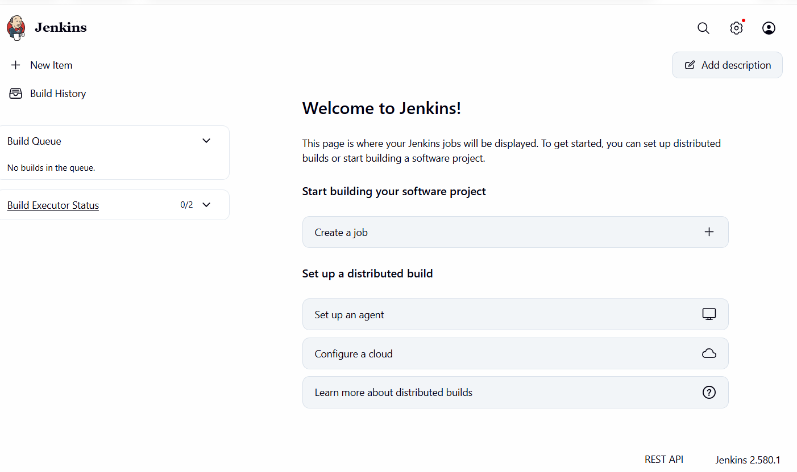
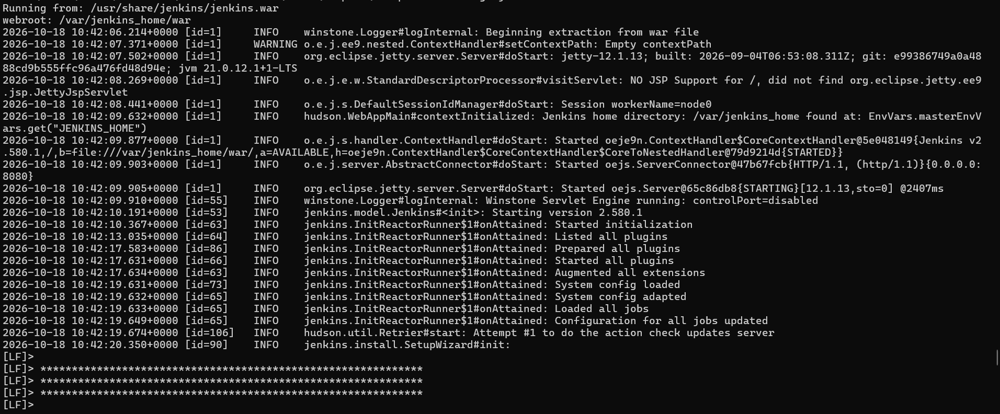

# Lab 7: Installing Jenkins

[Back to assignment index](../README.md)

Run the commands from the repository root unless a step specifies another directory.

I ran Jenkins in Docker. I built the image with Java 21, Python, Git, the Docker CLI, and the Pipeline and Git plugins because the other exercises needed these tools too.

From the repository folder in PowerShell, I ran:

```powershell
docker build --progress=plain -t devops-jenkins:lab07 .\lab-07
docker run -d --name jenkins --restart unless-stopped --group-add 0 -p 127.0.0.1:8081:8080 -v devops-jenkins-home:/var/jenkins_home -v /var/run/docker.sock:/var/run/docker.sock --mount "type=bind,source=$($PWD.Path),target=/opt/devops-labs,readonly" devops-jenkins:lab07
docker ps -a --filter "name=^/jenkins$"
```

I used port 8081 because another app was already using 8080. The `devops-jenkins-home` volume stores Jenkins's settings. I mounted the Docker socket so Jenkins could run the container commands, and mounted the repository read-only at `/opt/devops-labs` for the first local tests.

I opened `http://localhost:8081/`. Reading the initial password file returned `No such file or directory`, so I checked the startup log locally with `docker logs jenkins` and used the generated password shown there to unlock Jenkins. I kept the password out of this repository.

I installed the suggested plugins, created my administrator account, kept the Jenkins URL as `http://localhost:8081/`, and finished setup. The welcome dashboard opened successfully and showed Jenkins 2.580.1.



## Additional screenshots


