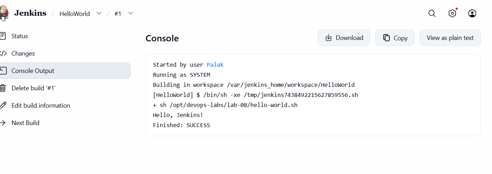

# Lab 8: Hello World Jenkins Job

[Back to all labs](../)

Run the commands from the repository root unless a step specifies another directory.

I created a Freestyle project named `HelloWorld`. For the first run, I left Source Code Management as `None` and added an Execute shell build step:

```sh
sh /opt/devops-labs/lab-08/hello-world.sh
```

This used the script from the repository folder mounted into Jenkins. I clicked Save, then Build Now, and opened build #1's Console Output. It printed:

```text
Hello, Jenkins!
Finished: SUCCESS
```

This run verified the local script. GitHub checkout was not used for this build.



After uploading the remaining lab files to GitHub, I changed HelloWorld's Source Code Management to Git, entered `https://github.com/palak12-30/devOps.git`, left credentials unset for the public repository, and selected branch `*/main`. I changed the Execute shell step to use the script from the checked-out workspace:

```sh
sh lab-08/hello-world.sh
```

Build #3 fetched the script from GitHub at commit `2730b3f` on `origin/main`. It printed `Hello, Jenkins!` and finished successfully, so I had checked both the local script and the GitHub checkout.
