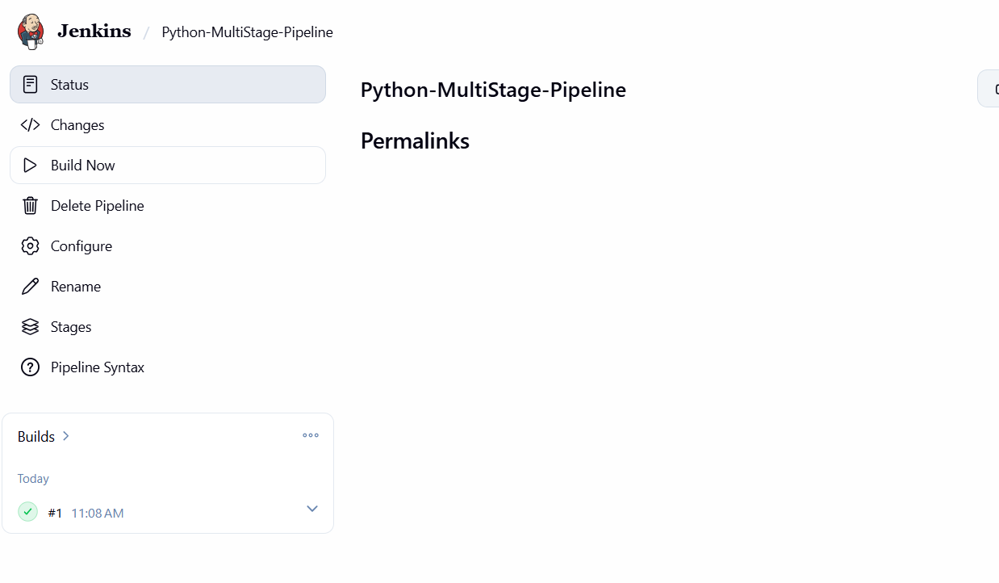

# Lab 9: Multi-Stage Flask Pipeline

[Back to assignment index](../README.md)

Run the commands from the repository root unless a step specifies another directory.

I created a Pipeline job named `Python-MultiStage-Pipeline`. I copied `lab-09/Jenkinsfile` into the Pipeline script field and kept the Groovy sandbox enabled. For build #1, `USE_LOCAL_SOURCE` was enabled, so Jenkins copied the application files from `/opt/devops-labs/lab-09` into its workspace.

I used all five stages from the exercise. Python was already installed in my Jenkins image, and the Build stage installed Flask 3.1.3 in a virtual environment.

| Stage | What happened in build #1 |
| --- | --- |
| Build | Created `.venv` and installed Flask and its dependencies. |
| Test | Ran `test_home`; the response status and greeting matched, and the test passed. |
| Deploy | Copied `app.py` and `requirements.txt` into the workspace's `lab-09/python-app-deploy` folder as a mock deployment. |
| Run Application | Started the copied Flask application in the background. |
| Test Application | Requested the running server and received `HTTP 200: Hello, Jenkins Multi-Stage Pipeline!`. |

The post-build step stopped the Flask process, removed its PID file, and archived `app.log`. The console ended with `Pipeline completed successfully!` and `Finished: SUCCESS`.

This verified the pipeline using the mounted local files. Build #1 did not check out the application from GitHub.

After pushing the files, I changed the job's Definition to `Pipeline script from SCM`, selected Git, entered `https://github.com/palak12-30/devOps.git`, set the branch to `*/main`, and used `lab-09/Jenkinsfile` as the Script Path. I ran Build with Parameters with `USE_LOCAL_SOURCE` unchecked.

Build #2 read the Jenkinsfile and application source from GitHub at commit `2730b3f`. All five stages passed again. The unit test was `OK`, and the running server returned `HTTP 200: Hello, Jenkins Multi-Stage Pipeline!`. Jenkins then stopped the server and saved its log. The final result was `Finished: SUCCESS`.
