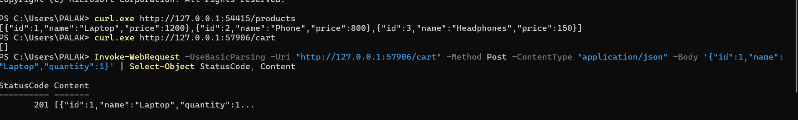
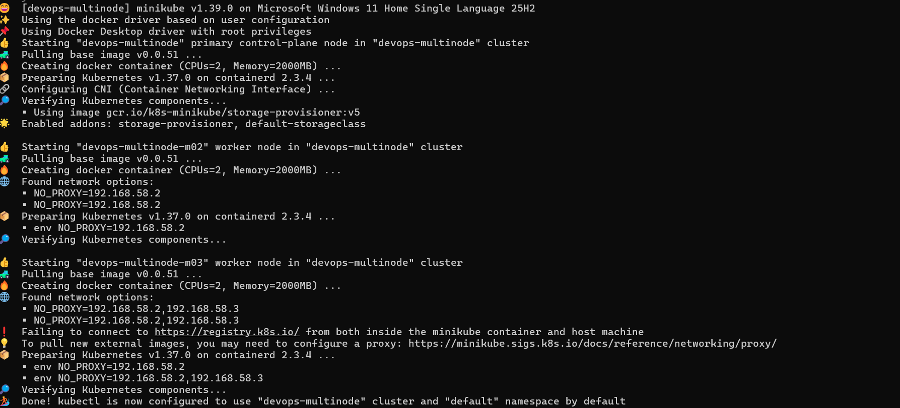
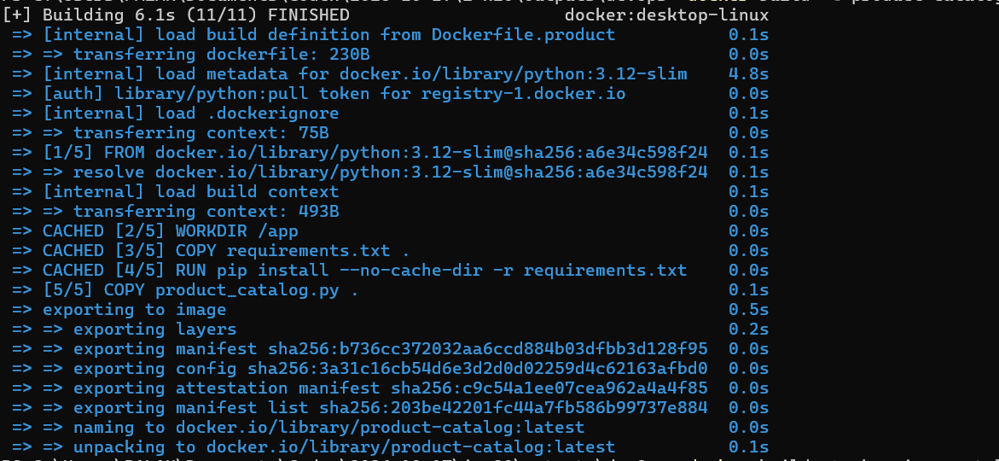
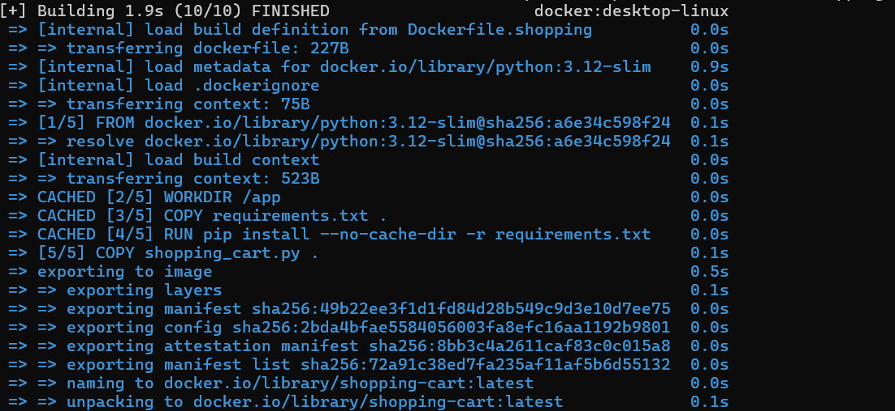
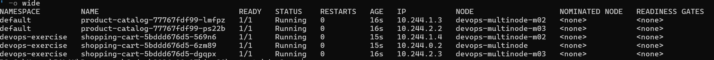

# Lab 10: Multiple Applications on Three Kubernetes Nodes

[Back to assignment index](../README.md)

Run the commands from the repository root unless a step specifies another directory.

I created a separate Minikube profile for the multi-node exercise:

```powershell
C:\minikube\minikube.exe start -p devops-multinode --driver=docker --nodes=3 --cpus=2 --memory=2000
kubectl --context=devops-multinode wait --for=condition=Ready nodes --all --timeout=300s
kubectl --context=devops-multinode get nodes
```

Minikube reported a connection warning for `registry.k8s.io` while starting the third node, but cluster creation completed. The third node was initially `NotReady`; it finished starting without a configuration change. The wait command then succeeded for all three nodes.

| Node | Status | Role |
| --- | --- | --- |
| devops-multinode | Ready | Control plane |
| devops-multinode-m02 | Ready | Worker |
| devops-multinode-m03 | Ready | Worker |

All three nodes ran Kubernetes v1.37.0 with containerd 2.3.4.

I used the handout's Product Catalog and Shopping Cart Flask applications, with Python 3.12 and Flask 3.1.3. The catalog serves `/products`; the cart supports GET and POST requests at `/cart`.

From the repository folder, I built both images and loaded them into the multi-node profile:

```powershell
docker build -t product-catalog:latest -f .\lab-10\Dockerfile.product .\lab-10
docker build -t shopping-cart:latest -f .\lab-10\Dockerfile.shopping .\lab-10
C:\minikube\minikube.exe -p devops-multinode image load product-catalog:latest
C:\minikube\minikube.exe -p devops-multinode image load shopping-cart:latest
```

Both images built, and the load commands finished without errors. I loaded the images directly into Minikube's node runtimes, so I did not need to enable the registry add-on.

I created the `devops-exercise` namespace and applied the manifests:

```powershell
kubectl --context=devops-multinode apply -f .\lab-10\namespace.yaml
kubectl --context=devops-multinode apply -f .\lab-10\
kubectl --context=devops-multinode rollout status deployment/product-catalog --timeout=180s
kubectl --context=devops-multinode -n devops-exercise rollout status deployment/shopping-cart --timeout=180s
kubectl --context=devops-multinode get pods -A -l 'app in (product-catalog,shopping-cart)' -o wide
```

I put Product Catalog in `default` and Shopping Cart in `devops-exercise`. The handout's shopping-cart Service used a different namespace from its Deployment, so I corrected them to match. The Pod anti-affinity rule keeps copies of the same app on different nodes. I also added readiness checks and CPU/memory requests and limits.

Both rollouts succeeded. All five Pods were `1/1 Running` with zero restarts:

| Application | Pod suffix | Node |
| --- | --- | --- |
| Product Catalog | lmfpz | devops-multinode-m02 |
| Product Catalog | ps22b | devops-multinode-m03 |
| Shopping Cart | 569n6 | devops-multinode-m02 |
| Shopping Cart | 6zm89 | devops-multinode |
| Shopping Cart | dgqpx | devops-multinode-m03 |

I opened a separate PowerShell window for each service tunnel and left both running:

```powershell
C:\minikube\minikube.exe -p devops-multinode service product-catalog-service --url
C:\minikube\minikube.exe -p devops-multinode service shopping-cart-service -n devops-exercise --url
```

The catalog tunnel returned `http://127.0.0.1:54415` and the cart tunnel returned `http://127.0.0.1:57906`. These ports were assigned for this run and may change after restarting a tunnel.

In another PowerShell window, I tested both applications:

```powershell
curl.exe http://127.0.0.1:54415/products
curl.exe http://127.0.0.1:57906/cart
Invoke-WebRequest -UseBasicParsing -Uri "http://127.0.0.1:57906/cart" -Method Post -ContentType "application/json" -Body '{"id":1,"name":"Laptop","quantity":1}' | Select-Object StatusCode, Content
```

The catalog returned Laptop (1200), Phone (800), and Headphones (150). The initial cart response was `[]`. Adding a Laptop returned HTTP `201` with the added item in the response.



The apps responded through their Services, and the Pod listing showed the required placement across nodes. Each cart replica keeps its own list in memory. A later request may reach another replica and show a different cart; shared storage was not part of this sample app.


## Additional screenshots








